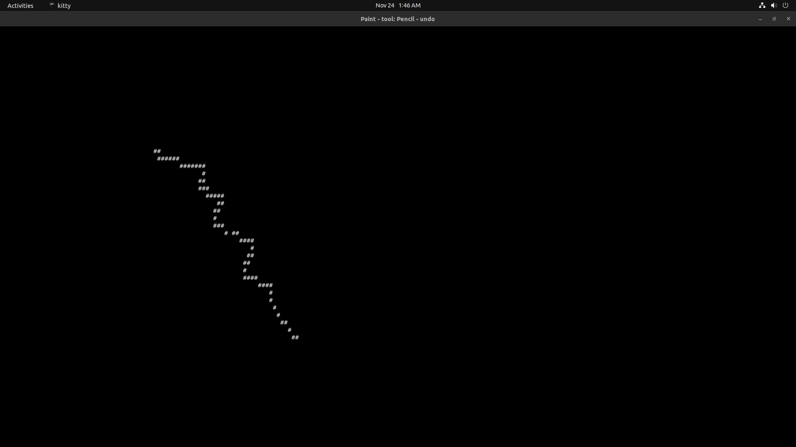
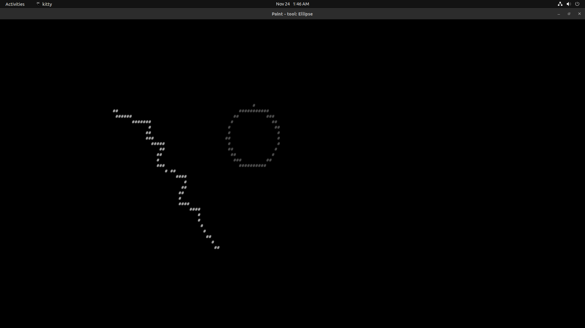
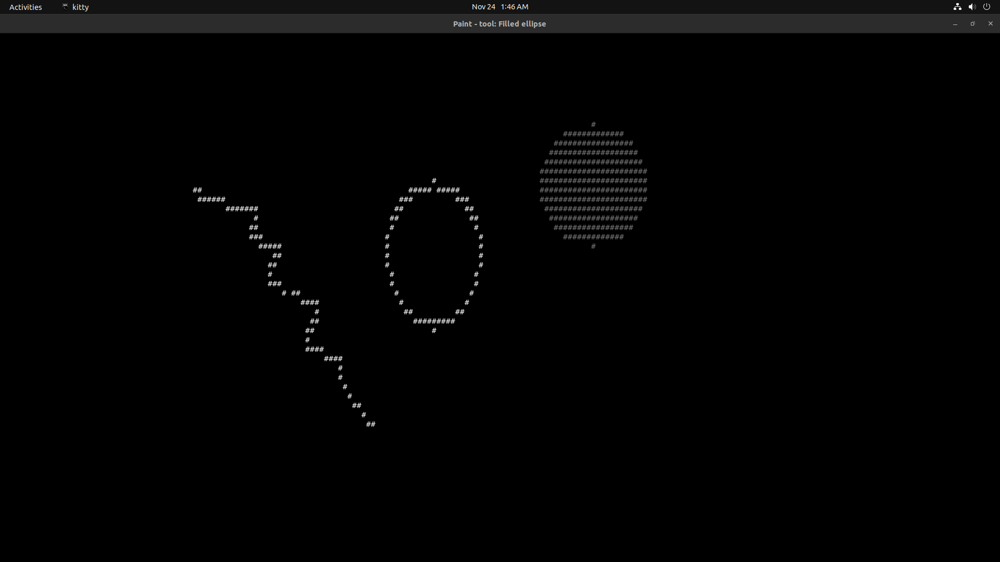
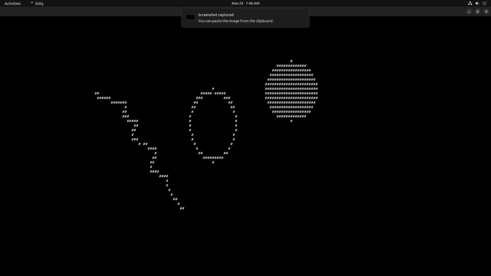
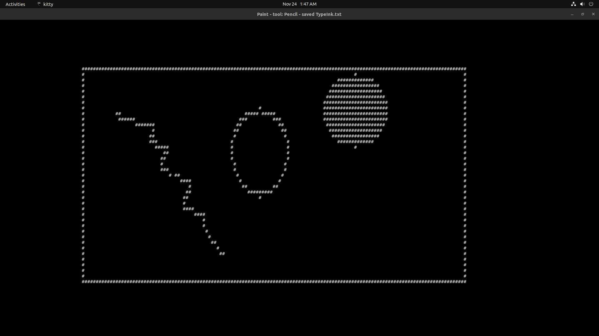
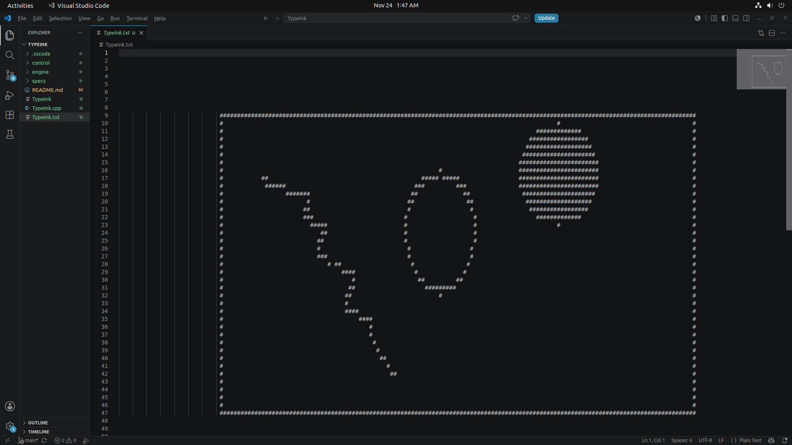

Tired of manually arranging characters to create ASCII diagrams and text-based art in your notes?

TypeInk lets you draw them visually on a terminal canvas and export the result as plain text.

Press Ctrl + P to export your canvas to TypeInk.txt, preserving the character layout and spacing—ready to copy into Obsidian, Markdown documents, README files, code comments, or anywhere plain text is useful.

Draw → Export → Paste.

---

# TypeInk

<div align="center">


**The terminal is your canvas.**

*A zero-dependency C++ paint program — seven tools, live grey previews,
real undo/redo, and one-key export to plain text, right inside the
terminal you already have.*

</div>

---

<div align="center">
  
  
  
</div>
<div align="center">
  
  
  
</div>

---
## Important Note

TypeInk is designed for **POSIX terminals** (Linux, macOS, BSD, WSL) and
requires **ANSI escape codes**, **mouse reporting** (`?1003` any-motion
tracking) and **24-bit true color** support.

Everything else is handled by the two provided modules: the input layer
reads raw key chords and mouse edges for you, and the engine sizes the
character grid from the OS at startup. There is no configuration file, no
build system, no dependency to install — **one compile command builds all
three layers.**

my pc specs for reference:
```
            .-/+oossssoo+/-.                
        `:+ssssssssssssssssss+:`           ------------------------- 
      -+ssssssssssssssssssyyssss+-         OS: Ubuntu 22.04.5 LTS x86_64 
    .ossssssssssssssssssdMMMNysssso.       Host: MS-7C52 1.0 
   /ssssssssssshdmmNNmmyNMMMMhssssss/      Kernel: 6.8.0-136-generic 
  +ssssssssshmydMMMMMMMNddddyssssssss+     Uptime: 4 hours, 29 mins 
 /sssssssshNMMMyhhyyyyhmNMMMNhssssssss/    Packages: 2169 (dpkg), 14 (snap) 
.ssssssssdMMMNhsssssssssshNMMMdssssssss.   Shell: bash 5.1.16 
+sssshhhyNMMNyssssssssssssyNMMMysssssss+   Resolution: 1920x1080 
ossyNMMMNyMMhsssssssssssssshmmmhssssssso   DE: GNOME 42.9 
ossyNMMMNyMMhsssssssssssssshmmmhssssssso   WM: Mutter 
+sssshhhyNMMNyssssssssssssyNMMMysssssss+   WM Theme: Adwaita 
.ssssssssdMMMNhsssssssssshNMMMdssssssss.   Theme: Yaru-blue-dark [GTK2/3] 
 /sssssssshNMMMyhhyyyyhdNMMMNhssssssss/    Icons: Yaru-blue [GTK2/3] 
  +sssssssssdmydMMMMMMMMddddyssssssss+     Terminal: gnome-terminal 
   /ssssssssssshdmNNNNmyNMMMMhssssss/      CPU: AMD Ryzen 5 5600G with Radeon G 
    .ossssssssssssssssssdMMMNysssso.       GPU: AMD ATI 30:00.0 Cezanne 
      -+sssssssssssssssssyyyssss+-         Memory: 9358MiB / 19891MiB 
        `:+ssssssssssssssssss+:`
            .-/+oossssoo+/-.                                       
```                                                    

---

## 📖 Table of Contents

- [Overview](#-overview)
- [Features](#-features)
- [The Two Families](#-the-two-families)
- [Architecture](#-architecture)
- [Quick Start](#-quick-start)
- [Controls](#-controls)
- [Use Cases](#-use-cases)
- [Why TypeInk](#-why-typeink)
- [Comparison](#-comparison)
- [Design Philosophy](#-design-philosophy)
- [Things To Be Noticed](#-things-to-be-noticed)
- [License](#-license)

---

## 🌟 Overview

TypeInk is a paint program that lives entirely inside your terminal. It
takes the character grid you are already looking at — and turns it into a
canvas. Pencil, eraser, line, rectangle, ellipse: armed with a key chord,
anchored with a click, previewed live in grey, committed in white ink.

The name is a collision of two ideas: **"Type"** and **"Ink"**. The whole
keyboard is the brush — type any printable character and it becomes the ink
that strokes and shapes are drawn with. A `#` brush draws `#`-shaped
ellipses. An `@` brush signs your name across the grid. And when the
drawing is done, `ctrl+p` types the whole canvas into `TypeInk.txt`,
character for character, exactly as it looks on screen.

The terminal stops being a place where text is *printed* and becomes a
place where pictures are *drawn*.

### Why a Character Canvas?

Terminals are fast, sharp, and everywhere. But drawing in one usually means
adopting a full TUI framework — or nothing at all. TypeInk gives the grid a
pointer and a paintbox.

- **Zero Dependencies** — No libraries. No frameworks. No linker headaches.
  Just C++ and the terminal you're already sitting in.
- **Three-Layer Architecture** — A provided input layer, a provided
  framebuffer engine, and one application file that is yours to edit.
- **The Keyboard Is the Brush** — Every printable character is ink, for
  freehand strokes *and* shapes.
- **Live Grey Previews** — Every shape traces under the cursor before it
  commits, pixel-identical to what lands.
- **Real Undo / Redo** — Whole-canvas snapshots with textbook editor
  semantics.
- **Plain-Text Export** — Your drawing is a `.txt` file anyone can open.

---

## ✨ Features

### 🖌 Rich Drawing Tools
- **Seven Tools** — Pencil, eraser, line, rectangle, filled rectangle,
  ellipse, filled ellipse
- **Any Character as Ink** — Type it, draw with it; the brush applies to
  freehand strokes *and* shapes
- **Hold Tools** — Pencil and eraser paint while the button is down
- **Toggle Shape Tools** — Arm with a chord, anchor with a click, commit
  with a second click; one shape per arming
- **Typewriter Advance** — Typed characters paint and step forward,
  wrapping at the screen edge

### 🎬 Live Feedback
- **Grey Trace Preview** — Every shape follows the cursor in grey
  (`\033[90m`) before it is committed
- **Pixel-Identical Commit** — Preview and commit share the same
  rasterizers; what you see is exactly what lands
- **Window Title Status** — The active tool lives in the title (OSC 2);
  save, new-canvas, undo and redo results are reported there too
- **Arrow Pointer** — The terminal's mouse cursor is requested via OSC 22
  and restored on exit

### 🧠 History & Files
- **Whole-Canvas Undo / Redo** — `ctrl+z` / `ctrl+y` with standard editor
  semantics, capped at 100 steps
- **Stroke-Granular History** — A whole drag is one step, a shape is one
  step, a typed character is one step
- **New Canvas** — `ctrl+n` wipes the display; the wiped picture stays one
  `ctrl+z` away
- **Text Export** — `ctrl+p` writes `TypeInk.txt` into the working
  directory, preserving interior spacing exactly

### 🧩 Developer-Friendly
- **One Editable File** — `TypeInk.cpp` is the only file meant to change
- **One Handler per Input Source** — New inputs slot in without touching
  the other handlers
- **Safe by Default** — Bounds-checked drawing, clamped cursor, no
  out-of-grid writes
- **No Config Files** — Everything is set in code and documented here

---

## 🎭 The Two Families

Every tool in TypeInk belongs to one of two families. You feel the
difference in your hand.

### ▸ Hold Tools — *The Brush*

Pencil and eraser paint while the left button is down, cell by cell, like
ink flowing straight from your hand. What you drag is what you get — no
commit step, no ceremony.

**Feels like:** drawing on paper that never runs out of grid.

```text
ctrl+x  →  hold the button  →  drag  →  release
```

### ▸ Shape Tools — *The Compass*

Line, rectangle, filled rectangle, ellipse and filled ellipse are
toggle-based. A chord arms the tool, the first click anchors, the mouse
traces the shape **live in grey**, and the second click commits it into the
canvas in white ink. One shape per arming — then the pencil returns.

**Feels like:** a drafting compass snapping perfect geometry onto the grid.

```text
ctrl+l  →  click anchor  →  move (grey trace)  →  click commit
```

Both families share the same brush character, the same canvas and the same
undo history. A grey preview is never committed and never recorded — only
the second click makes it real.

---

## 🏗 Architecture

### The Three Files

```text
.
├── control
│   └── main.cpp        input layer (provided - do not modify)
├── engine
│   └── main.cpp        character framebuffer (provided - do not modify)
├── specs
│   └── README.md       controls and tables etc.
├── TypeInk.cpp         the paint application (edit freely)
└── README.md           this document
```

The layering is strict: `TypeInk.cpp` includes the two modules directly and
consumes them **only** through their exposed APIs.

```text
┌─────────────────────────────────────────────────────────────┐
│                     Application Layer                       │
│   ┌──────────────┐  ┌──────────────┐  ┌────────────────┐   │
│   │  7 tools +   │  │ undo / redo  │  │ ctrl+p export  │   │
│   │  frame loop  │  │  snapshots   │  │  TypeInk.txt   │   │
│   └──────────────┘  └──────────────┘  └────────────────┘   │
│                      TypeInk.cpp                            │
└─────────────────────────────────────────────────────────────┘
                            ↓
┌─────────────────────────────────────────────────────────────┐
│                       Input Layer                           │
│   ┌────────────────────────────────────────────────────┐   │
│   │   Key Chords  •  Mouse Edges  •  Raw write()       │   │
│   └────────────────────────────────────────────────────┘   │
│                    control/main.cpp    (provided)           │
└─────────────────────────────────────────────────────────────┘
                            ↓
┌─────────────────────────────────────────────────────────────┐
│                      Engine Layer                           │
│   ┌────────────────────────────────────────────────────┐   │
│   │   rows·cols Buffer  •  setChar  •  getBuffer       │   │
│   │   setDefaultColor  •  render()                     │   │
│   └────────────────────────────────────────────────────┘   │
│                     engine/main.cpp    (provided)           │
└─────────────────────────────────────────────────────────────┘
                            ↓
                    Terminal Display
```

### The Frame Pipeline

Once per loop pass:

```text
t.update()
  │
  ├─ selectTool        ctrl+letter chords: toggle / switch / cancel trace
  ├─ exportCanvas      ctrl+p: canvas buffer -> TypeInk.txt
  ├─ newCanvas         ctrl+n: record + wipe the canvas, back to pencil
  ├─ undoStep          ctrl+z: restore the previous recorded state
  ├─ redoStep          ctrl+y: restore the last undone state
  ├─ updateCursor      mouse -> text cursor (clamped)
  ├─ handleShapeClicks anchor click / commit click (records before commit)
  ├─ latch release     commit click tail is swallowed; drag = one undo step
  ├─ paintFreehand     pencil / eraser drag painting (records at first dab)
  ├─ moveCursorKeys    arrow keys
  ├─ typeCharacters    brush character + paint + advance (records per char)
  ├─ backspace         record + clear cell
  │
  ├─ stageTrace        pending shape -> trace layer (only if tracing)
  ├─ e.render()        full screen, white canvas
  └─ paintTrace        grey sparse overlay (only if tracing)
```

### Inside TypeInk.cpp

| Section | Contents                                                             |
|---------|----------------------------------------------------------------------|
| 1       | `Tool` enum, `toolName`, `isShapeTool`, `showTool` (OSC 2 title)      |
| 2       | `clearGrid`                                                          |
| 3       | Rasterizers: `drawLineShape` (Bresenham), `drawRectShape`, `drawEllipseShape`, `drawShape` dispatcher |
| 4       | Trace layer: `commitTrace`, `paintTrace`                              |
| 5       | `PaintState` + one handler per input source, incl. history helpers `pushUndo`, `restoreBuffer`, `cancelTrace` |
| 6       | `main()` — the frame pipeline                                         |

### The Engine Contract

The application touches the engine through exactly six doors:

| API                              | Used for                                              |
|----------------------------------|-------------------------------------------------------|
| `rows`, `cols`                   | bounds, loops, cursor clamping                        |
| `setChar(row, col, c)`           | pencil/eraser/typing, staging the trace, committing, undo restore |
| `getChar(row, col)`              | reading trace cells for commit and grey overlay       |
| `getBuffer()`                    | whole canvas as one string: ctrl+p export, ctrl+z/ctrl+y snapshots |
| `setDefaultColor("#RRGGBB")`     | the white ink every frame is rendered in              |
| `render()`                       | the one full-screen repaint per loop pass             |

The grey of the preview is emitted by the application itself (`\033[90m`)
— the engine exposes no color getter, and that is by design: one color per
render.

---

## 🚀 Quick Start

### Prerequisites

- **C++11 or higher** compiler (C++17 recommended)
- **POSIX terminal** — Linux, macOS, BSD, WSL
- **Mouse reporting + true color** — most modern terminals handle this

### Installation

```bash
# Clone the repository
git clone https://github.com/intriXlabs/TypeInk.git
cd TypeInk

# Compile — one command builds all three layers
g++ -std=c++17 TypeInk.cpp -o typeink

# Run
./typeink
```

### Your First Drawing (60 seconds)

1. **Draw** — hold the left button and drag. You are using the pencil with
   the default `#` brush.
2. **Type** — press `@`. The brush changes; what you type lands on the
   canvas and advances like a typewriter.
3. **Line** — press `ctrl+l`, click a start, move the mouse (watch the grey
   trace), click again to commit.
4. **Undo** — press `ctrl+z`. The line is gone. `ctrl+y` brings it back.
5. **Save** — press `ctrl+p`. Your drawing now exists as `TypeInk.txt`.
6. **Exit** — `ctrl+c` (or `Esc`). The terminal is restored.

The window title follows you the whole way: `TypeInk - tool: Line`.

---

## 🎮 Controls

`ctrl+c` is the program's quit key and is **never** used by a tool.

### Tool keys (ctrl + letter)

| Keys   | Tool            | Kind            | Drawing action                               |
|--------|-----------------|-----------------|----------------------------------------------|
| ctrl+x | Eraser          | hold            | erase (paint spaces) while dragging           |
| ctrl+l | Line            | shape (toggle)  | anchor point to end point                     |
| ctrl+r | Rectangle       | shape (toggle)  | corner to opposite corner, outline            |
| ctrl+f | Filled rect     | shape (toggle)  | corner to opposite corner, filled             |
| ctrl+e | Ellipse         | shape (toggle)  | fitted in the dragged bounding box, outline   |
| ctrl+o | Filled ellipse  | shape (toggle)  | fitted in the dragged bounding box, filled    |

The pencil needs no key: it is the tool at startup, it returns after every
shape commit and after `ctrl+n`, and pressing the key of an active tool
again disarms back to it.

### Keyboard

| Input           | Action                                                        |
|-----------------|---------------------------------------------------------------|
| any printable   | pick it as the brush character, paint it, advance like a typewriter |
| arrow keys      | move the text cursor one cell                                 |
| backspace       | clear the cell under the cursor                               |
| ctrl+p          | export the canvas to TypeInk.txt                              |
| ctrl+n          | wipe the canvas and start a new drawing                       |
| ctrl+z          | undo the last action                                          |
| ctrl+y          | redo the last undone action                                   |
| Esc             | quit                                                          |
| ctrl+c          | quit (reserved by the input layer)                            |

### History rules (ctrl+z / ctrl+y)

- Every canvas-mutating action records the buffer **before** it changes
  anything — one action, one undo step.
- A whole pencil / eraser drag records once at its first dab; a shape
  records at its commit click; typing, backspace and `ctrl+n` record per
  press.
- Any new action discards the redo branch, exactly like a text editor.
- Identical consecutive records are skipped, so no-op spam never floods
  the history. The cap is 100 steps; the oldest is dropped beyond it.
- Undo / redo cancel a grey shape trace in progress, so no stale preview
  survives a restore.

### The shape flow, precisely

1. `ctrl+<letter>` **arms** the tool — the title updates.
2. **First left click** anchors the shape at that cell.
3. **Moving the mouse** traces the shape **live in grey**. Preview only —
   the rest of the canvas stays white and untouched.
4. **Second left click** commits in the default white, at the exact release
   point; the tool falls back to the pencil.
5. Pressing the same key again *before* anchoring disarms back to pencil.
6. Pressing any tool key **while a trace is live** cancels the preview
   without committing.

A short "latch" after the commit click swallows the tail of that same
button press, so committing can never smear stray pencil pixels.

### Export (ctrl+p)

- One line per terminal row, character for character what the canvas holds;
  interior spacing is preserved exactly.
- Trailing spaces at the end of a line are dropped — they are invisible on
  screen.
- The file is **overwritten** on every export. A grey trace in progress is
  a preview only, so it is never exported.
- The title confirms: `TypeInk - tool: Pencil - saved TypeInk.txt` (or
  `... - save failed`).

---

## 🎯 Use Cases

### 1. ASCII Art & Diagrams
Sketch doodles, box-and-line diagrams and pixel art without leaving the
terminal — then `ctrl+p` and the art is a shareable `.txt`:

```text
    ###########
   #           #
  #  @@     @@  #
  #             #
  #    \____/   #
   #           #
    ###########
```

### 2. Terminal-First Mockups
Block out a TUI layout or a CLI screen before writing any code — in the
same grid the real app will live in.

### 3. Teaching & Demos
The three-layer codebase *is* the lesson: raw input handling, escape
sequences, framebuffer rendering and event loops, each in one readable
file.

### 4. Game Map Editing
Sketch roguelike levels and tile maps with any brush character the game
engine understands, then hand the file straight to your loader.

### 5. SSH Scratchpad
One binary, zero dependencies — draw on remote boxes over plain SSH, no
X11, no port forwarding, no desktop.

---

## 🌈 Why TypeInk

Most terminal drawing falls into one of two camps: full TUI frameworks
that want to own your whole screen and your weekend, or nothing at all.
TypeInk sits in between.

It doesn't manage windows. It doesn't ask for a build system, a config
file, or a new way of thinking. It uses the grid that is already there,
the keys that are already under your fingers, and the characters that are
already ink.

If you want to **draw** in the terminal — right now, in three files, with
zero dependencies — this is what it's for.

---

## ⚖️ Comparison

| | **TypeInk** | Manual printf art | Full TUI frameworks |
|---|---|---|---|
| **Dependencies** | None | None | Several |
| **Setup** | One compile command | Trivial | Framework to learn |
| **Shape tools** | 7, with live grey preview | None | Build them yourself |
| **Undo / redo** | Whole-canvas, 100 steps | None | Manual |
| **Text export** | One keypress, exact | Copy-paste | Varies |
| **Input handling** | Provided layer (chords, mouse) | Hand-rolled | Provided |
| **Scope** | Drawing only | Printing only | Full-screen UI |
| **Feel** | Alive, instant | Static | Functional, boxy |
| **Learning curve** | Minutes | Seconds | Hours to days |

TypeInk isn't trying to replace your TUI library. It's trying to make the
terminal *drawable*.

---

## 🧬 Design Philosophy

TypeInk is small on purpose.

- **Three layers, one owner** — input and rendering are provided modules;
  `TypeInk.cpp` is the only file meant to be edited. The boundary is the
  API list above, nothing more.
- **One handler per input source** — tool keys, mouse, typing, history:
  each gets one function, so new inputs slot in without touching the rest.
- **The canvas is just characters** — no per-cell colors, no structures.
  That is why undo is a string copy and export is a buffer dump.
- **Everything is meant to be tuned** — brush character, tool keys,
  history depth (`kMaxHistorySteps`), the grey of the preview. Reshaping
  it is the intended use.

Adding a shape tool is a five-ingredient recipe: one enum value, one name,
one `isShapeTool` entry, one key branch, one rasterizer case. Arming,
anchoring, the grey trace, commit, title and undo history all come free
from the shared pipeline.

---

## ⚠️ Things To Be Noticed

These behaviors are recorded, deliberate, and worth knowing before you
change anything:

- **One color per render.** `engine.render()` repaints the whole screen in
  a single color every frame. Two full renders can never be layered — the
  second one's spaces erase the first. That is why the grey preview is
  *not* a second render: it is a sparse overlay written after the white
  repaint, cell by cell, only where the shape is. Copy the canvas into a
  grey-rendered engine and the **entire screen** turns grey — the classic
  mistake.
- **Some ctrl chords never arrive.** The terminal consumes `ctrl+h` /
  `ctrl+i` / `ctrl+j` / `ctrl+m` as backspace, tab, linefeed and enter,
  and `ctrl+c` is reserved for quitting. Tool keys live everywhere else.
- **The commit click is latched.** The tail of the second click — the one
  that commits a shape — would otherwise smear pencil pixels across the
  canvas. A latch swallows it until the button is released.
- **A space brush draws invisible shapes.** Preview and commit use the
  same brush character, so a space brush is consistent — and pointless.
  Pick a visible character.
- **Trailing spaces never reach the file.** `TypeInk.txt` drops the
  invisible end-of-line spaces; interior spacing is preserved exactly.
- **Undo history is memory-only.** It dies with the process and is capped
  at 100 whole-canvas snapshots.

---

## 📄 License

Licensed under the MIT License. See [LICENSE](LICENSE) for details.

---

<div align="center">

**Built for the terminal.**

*"A key arms the tool. A click anchors. The canvas remembers."*

[⬆ Back to Top](#typeink)

</div>